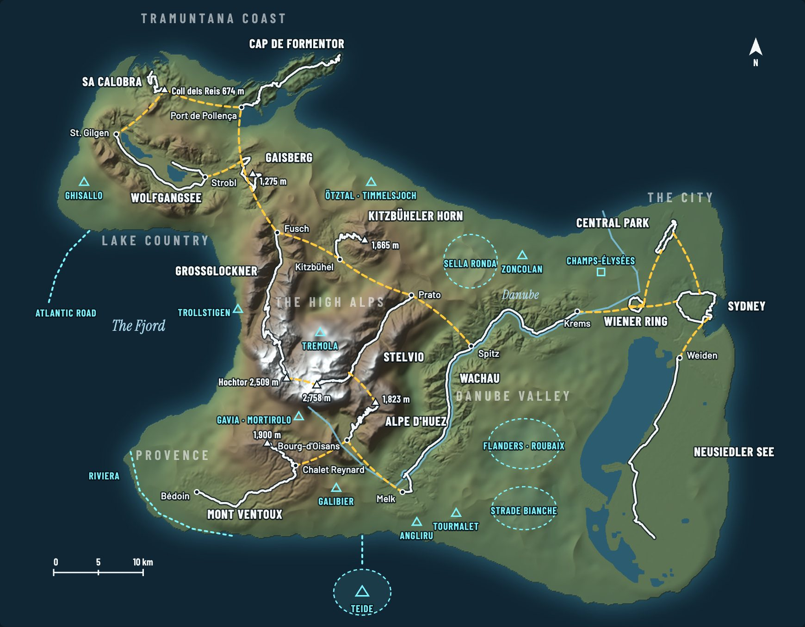

# Serpentine Island

The plan for one world (draft of 2026-10-25): all fourteen routes on one invented island, joined by new roads, so
you can ride from the Mallorca coast over the Alps to the city without a loading screen, like Los Santos in GTA or
Zwift's Watopia. Each route keeps its real road, heights, aerial photos, buildings and trees; the land and roads
between them are made up to fit. "Serpentine Island" is a working name.



The interactive version is [island.html](island.html) (open it in a browser; hover a road for its numbers, the
buttons show the loops). It lists every new road with length, height and gradient, and every place to add later.

254 km of real road, about 150 km of new road in 17 links, about 75 × 60 km (a bit smaller than Mallorca), highest
road 2,758 m on the Stelvio.

## How it fits together

- **Real heights stay real.** Every summit keeps its true height, so the island is high in the middle and low at
  the coast: Mallorca and Sydney on the sea, the lakes at 550 m, the alpine villages at 720–900 m, the passes above.
- **North stays up.** Routes are moved, never turned, so the light in their aerial photos matches the sun.
- **Each route brings its surroundings:** about 1.5 km of real ground either side of the road (more for the
  Wolfgangsee and the Neusiedler See, less in the cities), then a soft seam into invented land.
- **New roads are short and rideable:** mostly 5 to 11 km, at most about 6.5 % on average, hairpins where needed.
- **Real junctions where they exist:** the Sault road joins the Ventoux at Chalet Reynard as in France; Strobl and
  Spitz are real places on their routes.
- **Summits that end in reality end here too:** Gaisberg, Kitzbüheler Horn, Ventoux, the Formentor lighthouse and
  the port of Sa Calobra are turnarounds.

## Regions

| Region | Routes | Heights |
| --- | --- | --- |
| Tramuntana coast (north) | Sa Calobra, Cap de Formentor, joined by the Coast road over the Coll dels Reis | 0–674 m |
| Lake country | Wolfgangsee, Gaisberg | 540–1,275 m |
| The High Alps (middle) | Großglockner, Stelvio, Kitzbüheler Horn, Alpe d'Huez round one snowy core; valley road below, High road across the top | 720–2,758 m |
| Provence (southwest) | Mont Ventoux, reached by the Sault road from Bourg | 309–1,900 m |
| Danube valley | Wachau. The Danube rises in the Alps, runs through a gorge to Melk and past Vienna to the sea | 197–253 m |
| The City and the lake (east) | Wiener Ring, Central Park and Sydney's coast as three quarters of one city; the Neusiedler See south of it | 4–179 m |

## Loops

| Loop | km | Climbing |
| --- | ---: | ---: |
| The two giants: Großglockner up, the High road, down the Stelvio, back along the valley | 77 | ~2,200 m |
| Danube and the Alpe: Prato to Spitz, the Wachau to Melk, the gorge to Bourg, Alpe d'Huez, the Col road back | 78 | ~1,700 m |
| Tramuntana and the lakes: Port de Pollença, Coll dels Reis, Wolfgangsee to Strobl, Gaisberg, down to the sea | 48 | ~800 m |
| Three cities: the Ring, Central Park and Bondi joined by new streets | 43 | ~450 m |

Plus the out-and-back climbs from each loop; everything at once is about 400 km.

## Riding it

- **Junctions:** the HUD shows the turn ahead; the Zwift Ride's D-pad or the arrow keys pick it. Without a choice
  you stay on your road.
- **World map:** where you are, and start anywhere.
- **Named routes stay:** "Ride the Stelvio" starts in Prato with the same banners, records, ghosts and segments.
- **GPS and Strava:** the island has no real place on Earth, so rides get coordinates on an empty patch of ocean
  (as Zwift does with Watopia) and show as a Virtual Ride. Real Strava segments can't match there; the app still
  knows the real road under the rider and can time them itself. Today's single routes stay, with real GPS.

## Later: famous places to add

Faded on the map. **First** marks where to start: the biggest names for the least new road, and riding the island
doesn't have yet.

| Place | Where it goes | Needs |
| --- | --- | --- |
| Galibier (**first**) | South of Bourg-d'Oisans: a real neighbour of Alpe d'Huez via the Col du Lautaret | nothing new |
| Flanders bergs and Paris–Roubaix sectors, Roubaix velodrome (**first**) | The flat land inside the Danube's bend | cobbles (look, rumble, rolling resistance) |
| Sella Ronda (**first**) | Northeast of the Alps, off the valley road at Prato; a real loop of four passes, ~55 km | Dolomite art |
| Trollstigen and the Atlantic Road (**first**) | Head and mouth of the fjord | Nordic art, bridges over water |
| Champs-Élysées (**first**) | A fourth quarter of the City | city art |
| Gavia, Mortirolo | Far side of the Stelvio, around Bormio, as in reality | nothing new |
| Tremola (Gotthard) | Across the snowy core | cobbles |
| Zoncolan | Next to the Dolomites | nothing new |
| Ötztal: Kühtai, Timmelsjoch | Tyrol, north of Kitzbühel | nothing new |
| Madonna del Ghisallo | Lake country, west of St. Gilgen | nothing new |
| Teide | A volcano island off the south coast, with a bridge | volcano art, a bridge |
| Riviera: Cipressa, Poggio | Southwest coast, next to Provence | Mediterranean coast art |
| Tourmalet, Angliru | A ridge south of Melk | nothing new |
| Strade Bianche | The open south | gravel, Tuscany art |

Switzerland and France publish free aerial photos as Austria does, so Galibier, Tourmalet, Tremola and Roubaix
could look as sharp as Gaisberg.

## Build order

1. **Spike: two routes and one road.** Gaisberg and Wolfgangsee joined by the 5.5 km Strobl road: the land builder
   (real ground inside, filled land outside, the seam), one new road, a junction, streaming; measured on the M5 Max
   and an older MacBook Air. 1–2 weeks.
2. **The hard seam.** Cap de Formentor over the Down to the sea road: sea level to mountains, Mallorca photos next
   to Austrian ones, two biomes blending. About a week.
3. **The High Alps, the first world you can ride.** Großglockner, Stelvio, Kitzbüheler Horn and Alpe d'Huez with
   the valley roads, High road and Col road (77 km real, ~40 km new). World map, rides on the road network, FIT
   files with island coordinates. 3–5 weeks.
4. **Coast, lakes, Danube and Ventoux,** region by region.
5. **The City** last: invented streets and buildings between three real cities are the most art work.
6. **Ride together on the island** (the 1.3 relay).

A few months in all; each step ships on its own and today's routes keep working. 1.1's engine work (ride time from
the clock, freeing memory after a ride) comes first, because streaming a world needs both.

## Still to decide

- The layout (move anything), the name, cities on the island or in their own world (suggested: on the island,
  last), keeping real heights (suggested), keeping today's single routes with real GPS (suggested).

## Regenerating the map

[`scripts/world/layout.json`](../../scripts/world/layout.json) is the layout: each route's start point in island km,
how much real ground it brings, the coastline, the rivers and the new roads. After changing it:

```sh
node scripts/world/layout.mjs        # checks gaps, slopes and gradients, prints every new road
python3 scripts/world/relief.py      # the relief (numpy, pillow; fetches AWS terrain tiles once)
node scripts/world/page.mjs          # writes docs/world/island.html
```

Intermediate files and the tile cache go to `$WORLD_OUT` (default: the system temp folder). Label positions and the
later places live in `page.mjs`. `map.jpg` is a screenshot of the page's map. The relief is a first test of the
land builder: real heights near the roads, the rest filled from the edges (Laplace) with rough hills, the coast and
rivers drawn by hand. Elevation: AWS Terrain Tiles (Mapzen terrain, SRTM and national DEMs).
